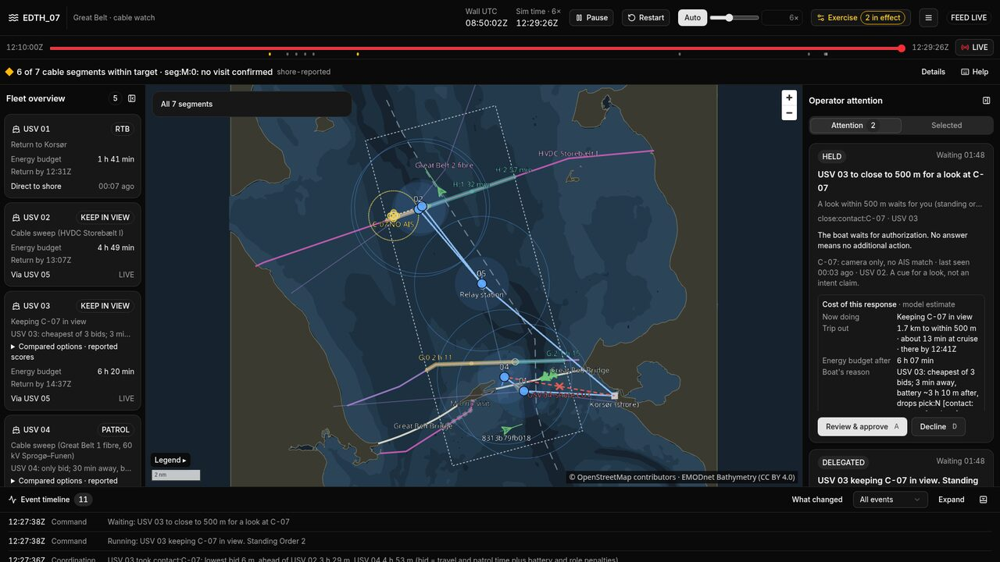

  

## Featured: Pharos

**A swarm brain for small patrol boats that guard undersea cables.** Built in one weekend at EDTH Copenhagen 2026 (Challenge 07, team Elysa's Secret).

Five uncrewed boats patrol three cables under the Great Belt with no leader. They share a task table over the radio and auction open work among themselves. When a boat runs low on battery or loses its link, the others take over its work. The shore console shows one watch officer only what the radio delivered, and anything beyond watching waits for their approval.

- **My part:** the swarm brain that runs on every boat (task table, leases, auctions, relay, contact handling, safe return on battery) and the message contract between Python and the TypeScript console.
- **Result:** across 30 paired simulation seeds, cable left overdue after a boat failure fell from 6.7 km to 1.4 km (median), better in every seed. The cost is stated too: fewer ship crossings stay in camera view, because five boats cannot cover everything.
- **Stack:** Python 3.12 (deterministic agents, simulator, evaluator), TypeScript with React, MapLibre and deck.gl, WebSockets. Runs fully offline.

[Repository: elysassecret/EDTH_07](https://github.com/elysassecret/EDTH_07)
