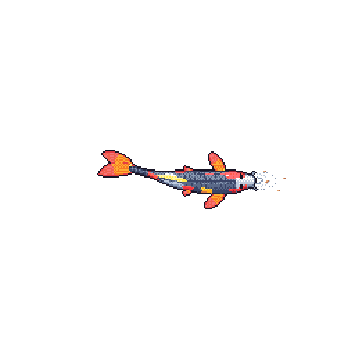

  

I'm Javier, a Computer Science student at the University of Southern Denmark. I love learning new things, and the best way I know is to build something with them. Right now I'm moving into hardware: I printed and assembled an SO-101 robot arm and I'm writing its control and vision code myself.

**[cv.javierarevalo.dev](https://cv.javierarevalo.dev)** · portfolio and CV

### Selected work

- **[Pharos](https://github.com/elysassecret/EDTH_07)** · A swarm brain for five uncrewed boats that guard undersea cables, built at EDTH Copenhagen 2026. When a boat fails, the others take over its work: cable left overdue fell from 6.7 km to 1.4 km (median, better in 30 of 30 simulated seeds). *Python, TypeScript.*
- **[Make-a-Ring](https://make-a-ring.deployxa.online)** · A 3D ring designer that exports print-ready files. **1st place of 738** at HyperBloom October 2026 (UI/UX and Web Design). *Preact, three.js.* [Case study](https://cv.javierarevalo.dev/work/make-a-ring/)
- **[Nordic AI Cup 2026](https://github.com/emermelada/nordic-ai-cup)** · Real-time drone object detection that steers its own camera, served as a live API with one graded attempt. I led our team on this challenge. *YOLO11, FastAPI, Docker.* [Case study](https://cv.javierarevalo.dev/work/nordic-ai-cup/)
- **[champions2paste](https://github.com/emermelada/champions2paste)** · Turns Pokémon Champions team screenshots into a valid paste for Pokémon Showdown, with deterministic OCR and no language model. *Python.*
